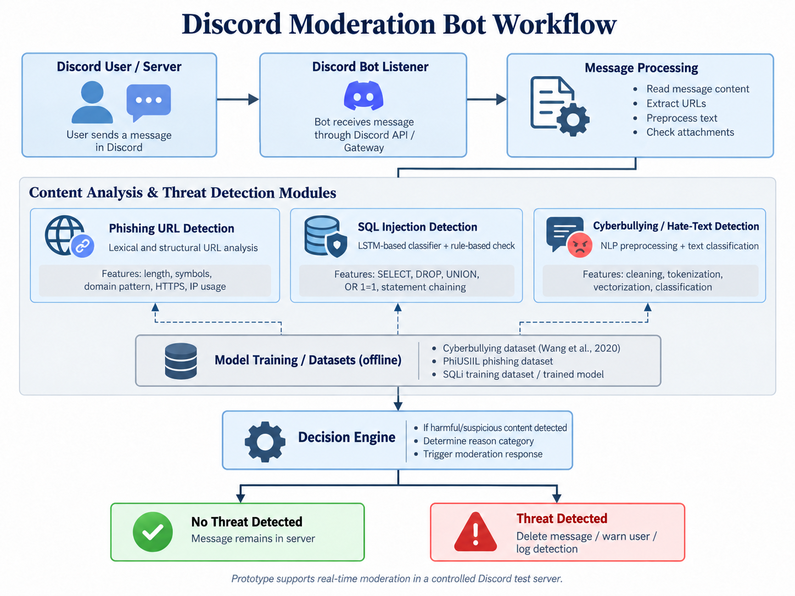

# A security & Content Rating Bot for Discord

MSc Cyber Security project, University of Chester (WB7103 / WB7104).

> **Content warning.** This project deals with abusive language. The code, the hostile
> vocabulary file (`models/hostile_lexicon.json`) and the test examples contain offensive
> terms, used only to detect and test for them.

## What it does

AiBot reads text messages posted in a Discord server and checks each one for three kinds of harm:

| Detector | Method | Data |
|---|---|---|
| Phishing links | 20 URL features, Random Forest of 100 trees, plus a brand-impersonation rule | PhiUSIIL, 235,795 URLs |
| SQL injection | Tokeniser + LSTM, plus a rule for chained destructive commands | Inherited model, training data not documented |
| Hateful / cyberbullying text | Language preprocessing, averaged word vectors, six-class neural classifier, plus a reviewed hostile vocabulary | Wang, Fu and Lu (2020), about 47,000 tweets |

When a message is flagged, the bot deletes it, mentions the sender with the reason (phishing
warnings show the model's confidence when the model made the call), and records the original message in a local audit
log, `moderation_log.csv`. It does **not** report or ban anyone: decisions about people stay
with human moderators. It is a proof of concept to support moderators, not to replace them.


## How it works



## Project structure

```
bot.py                   Discord bot: reads messages, runs the detectors, deletes and warns
cb_model.py              Cyberbullying / hate-text detector
phishing_model.py        Phishing-link detector (pure-Python Random Forest, no pickle)
sqli_model.py            SQL injection detector
train_phishing_model.py  Retrains the phishing model and exports models/phishing_forest.json
requirements.txt         Python dependencies
.env.example             Template for your Discord token (copy to .env)
models/
  cb_hatSpeech.joblib    Cyberbullying classifier
  mevectorizer.pickle    Word vectors for the cyberbullying classifier
  hostile_lexicon.json   Reviewed vocabulary of 42 hostile terms
  phishing_forest.json   Phishing model, stored as plain JSON
  sql_lstmv4.h5          SQL injection LSTM
  Wtokanizer.pickle      SQL injection tokeniser
```

## Setup

You need **Python 3.11**. TensorFlow 2.12 does not support Python 3.12 or newer.

```powershell
python -m venv venv
venv\Scripts\activate
pip install -r requirements.txt
```

1. Create a bot in the [Discord Developer Portal](https://discord.com/developers/applications).
   On the **Bot** tab, switch on **Message Content Intent**.
2. Invite the bot to a test server with the permissions **View Channels**, **Send Messages**
   and **Manage Messages** (needed to delete flagged messages).
3. Copy `.env.example` to `.env` and put your bot token in it. **Never commit `.env`.**
4. Run the bot:

```powershell
python bot.py
```

A correct start prints `We have logged in as ...` followed by `Hostile vocab : ACTIVE (42 terms)`.

Each detector can also be tested on its own:

```powershell
python cb_model.py
python phishing_model.py
python sqli_model.py
```

## Retraining the phishing model

Download the dataset (not included here) and run:

```powershell
python train_phishing_model.py path\to\PhiUSIIL_Phishing_URL_Dataset.csv
```

The script augments the legitimate URLs (in the raw data every one is a bare
`https://www.` homepage, which teaches a model that homepages are safe), trains the forest,
prints held-out accuracy (about 90%), and writes `models/phishing_forest.json`.

## Data sources

- **PhiUSIIL Phishing URL Dataset**: https://archive.ics.uci.edu/dataset/967/phiusiil+phishing+url+website
  Prasad, A. and Chandra, S. (2024) 'PhiUSIIL: A diverse security profile empowered phishing
  URL detection framework based on similarity index and incremental learning',
  *Computers & Security*, 136, 103545. https://doi.org/10.1016/j.cose.2023.103545
- **Cyberbullying Classification dataset**: https://www.kaggle.com/datasets/andrewmvd/cyberbullying-classification
  Wang, J., Fu, K. and Lu, C.T. (2020) 'SOSNet: A graph convolutional network approach to
  fine-grained cyberbullying detection', *2020 IEEE International Conference on Big Data*.
- **Evaluation data**: four labelled toxicity datasets (Wikipedia, Twitter, YouTube, Kaggle)
  were used to evaluate the cyberbullying classifier and to derive the hostile vocabulary.
  They are not redistributed here. [ADD SOURCE LINKS]

## Known limitations

- False positives and false negatives are possible; the bot has no sense of context, so
  friendly banter can be misjudged.
- Hostility that uses no word from the vocabulary is missed, including many direct threats and
  hate speech without profanity.
- The phishing model sees the structure of a URL only. A small rule catches links that pair a
  known brand with a lure word on an unofficial domain (for example `hsbc-secure.xyz/verify`),
  but it covers a short, editable list of brands (`BRAND_DOMAINS` in `phishing_model.py`).
  Look-alike spellings (`paypa1`), homograph domains and unlisted brands can slip through.
- The SQL injection detector's original training data is not documented.
- English only. Tested on a single test server, not with real communities.

## Privacy

`moderation_log.csv` stores usernames and the text of every flagged message. It is created
when the bot runs, is excluded by `.gitignore`, and should be kept private. A real
deployment would need a retention period, access limited to moderators, and a notice to
members that moderation is automated.

## Development note

Developed with AI assistance (Claude, by Anthropic) for code review, debugging and drafting.
Every change was tested before being kept, and the test results are reported in the project report.
